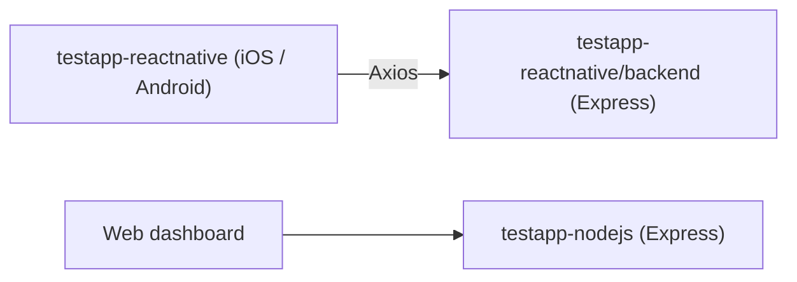

# NodeJS Samples

Sample Node.js projects: core-module demos, an Express test app, a React Native test app with its own backend, and a containerized web app with structured logging.

## 🚀 Quick Start

Each sub-project is self-contained. Pick one (here the Express test app), install it, and run it:

```bash
cd testapp-nodejs

npm install
npm start
curl http://localhost:4000/health
```

For prerequisites and per-project configuration, see **📋 Prerequisites & Dependencies** and
**⚙️ Build & Configuration** below.

### Usage

| Project | Run it with |
| ------- | ----------- |
| `nodejs-components` | `make start` (or `make all` to run every demo) |
| `testapp-nodejs` | `npm start` (or `npm run dev` for auto-reload) |
| `testapp-reactnative` | `npm start`, then `npm run ios` or `npm run android` |
| `testapp-reactnative/backend` | `npm install && npm start` |
| `webapp-nodejs` | `npm start` (or `just start-app` for Docker Compose) |

### Output

| Project | Default address |
| ------- | --------------- |
| `testapp-nodejs` | `http://localhost:4000` (dashboard at `/index.html`; opens in your browser on start) |
| `testapp-reactnative/backend` | `http://0.0.0.0:4000` |
| `webapp-nodejs` | `http://localhost:3000` |

## ✨ Features

- **Core modules** — plain CommonJS demos of `os`, `path`, `fs` (callbacks and promises) and streams, with no dependencies
- **Express test app** — health, system info, echo and test endpoints, plus a web dashboard
- **React Native test app** — iOS and Android client for the same endpoints, with an integrated backend
- **Structured logging** — a containerized app that logs one `pino` JSON line per request
- **Packaging** — `Dockerfile`, Docker Compose and Kubernetes manifests where noted

## 📋 Prerequisites & Dependencies

- Node.js `>= 18` (`webapp-nodejs` image uses `node:20-alpine`)
- `npm` (or `yarn` for the React Native app)
- `make` — for `nodejs-components`
- `just` and Docker — for `webapp-nodejs` container recipes
- `kubectl` (optional) — for the `webapp-nodejs` Kubernetes recipes
- macOS with Xcode — for the React Native iOS app
- Android Studio with the SDK and an emulator — for the React Native Android app

| Source | Purpose |
| ------ | ------- |
| `package.json` | Runtime and dev packages of each project — installed with `npm install` |
| Sub-projects | See **📚 References → In this repository** for each project's README |

For React Native environment setup, see [reactnative.dev/docs/environment-setup](https://reactnative.dev/docs/environment-setup).

## ⚙️ Build & Configuration

### Build

`nodejs-components` has no build step: it uses only Node's built-in modules. The other projects install with:

```bash
cd <project>
npm install
```

### Environment variables

| Variable | Projects | Default | Description |
| -------- | -------- | ------- | ----------- |
| `PORT` | `testapp-reactnative/backend`, `webapp-nodejs` | `4000` / `3000` | Server port |
| `HOST` | `testapp-reactnative/backend`, `webapp-nodejs` | `0.0.0.0` | Server bind address |
| `NODE_ENV` | `testapp-reactnative/backend` | `development` | Environment |
| `LOG_LEVEL` | `webapp-nodejs` | `info` | `pino` log level |

`testapp-nodejs` and `testapp-reactnative` also ship an `app-config.json`.

### Deploy

| Project | Files |
| ------- | ----- |
| `testapp-nodejs` | `Dockerfile`, `docker-compose.yml`, `zip-project.sh` |
| `testapp-reactnative/backend` | `Dockerfile`, `docker-compose.yml` |
| `webapp-nodejs` | `Dockerfile`, `docker-compose.yaml`, `deployment.yaml`, `Justfile` |

## 📁 Project Layout

```
NodeJS/
├── nodejs-components/              # Node.js core-module demos (CommonJS)
├── testapp-nodejs/                 # Express test app with web dashboard
├── testapp-reactnative/            # React Native test app
├── webapp-nodejs/                  # Containerized web app with pino logging
├── .gitignore                      # The .gitignore file
└── README.md                       ← you are here
```

## 🏗️ Architecture



### Components

| ID | Component | Location |
| -- | --------- | -------- |
| C1 | Express test app serving `/health`, `/info`, `/echo`, `/test/:message` and the dashboard | `testapp-nodejs/server.js` |
| C2 | React Native screens (Home, Health, System Info, Test, Echo) | `testapp-reactnative/src/screens/` |
| C3 | React Native API client | `testapp-reactnative/src/services/api.js` |
| C4 | React Native backend with the same endpoints | `testapp-reactnative/backend/server.js` |
| C5 | Containerized app with `/` and `/health` | `webapp-nodejs/app/server.js` |

## 🧪 Testing

```bash
cd testapp-nodejs && ./test.sh        # Express test app
cd testapp-reactnative && npm test    # React Native app (jest)
cd testapp-reactnative && npm run lint
cd webapp-nodejs && just curl-container   # health check against a running container
```

`webapp-nodejs` defines no automated tests: its `npm test` script is a placeholder that fails.

## 🛠️ Troubleshooting

| Issue | Fix |
| ----- | --- |
| Port already in use | Set `PORT` (where supported) or stop the conflicting process |
| `make check` reports an old Node.js | Install Node.js 18 or newer — `node -v` shows the current version |
| `just: command not found` | Install `just` — the `webapp-nodejs` recipes need it |
| React Native build fails | Check the environment setup linked in **📋 Prerequisites & Dependencies** |

## 📚 References

### In this repository

| Module | Link | Description |
| ------ | ---- | ----------- |
| `nodejs-components` | [nodejs-components/README.md](nodejs-components/README.md) | Node.js core-module demos: custom modules, `os`, `path`, `fs`, `fs.promises` and streams |
| `testapp-nodejs` | [testapp-nodejs/README.md](testapp-nodejs/README.md) | Express test app with health, system info, echo and test endpoints and a web dashboard |
| `testapp-reactnative` | [testapp-reactnative/README.md](testapp-reactnative/README.md) | React Native test app for iOS and Android with an integrated backend |
| `testapp-reactnative/backend` | [testapp-reactnative/backend/README.md](testapp-reactnative/backend/README.md) | Express backend serving the React Native app's API endpoints |
| `webapp-nodejs` | [webapp-nodejs/README.md](webapp-nodejs/README.md) | Containerized Node.js web app with structured `pino` logging |

### External Documentation

| Link | Description |
| ---- | ----------- |
| [Node.js documentation](https://nodejs.org/docs/latest/api/) | Node.js API reference |
| [Express](https://expressjs.com/) | Web framework used by the apps |
| [pino](https://getpino.io/) | JSON logger used by `webapp-nodejs` |
| [React Native environment setup](https://reactnative.dev/docs/environment-setup) | Toolchain for the iOS and Android builds |

## 📄 License

`testapp-nodejs` and `testapp-reactnative` declare the MIT license in their `package.json`, and `webapp-nodejs` declares ISC.

## 👤 Author

- **Rohtash Lakra** — [@rslakra](https://github.com/rslakra)
